## DISCLAIMER

**Please note that the documentation and comments are primarily in Portuguese. English translations are not provided, interested users should translate content as needed.**

# Administração de Sistemas - Relatório de Projeto

## Membros do grupo

- Ricardo Sá (up202408664)
- Luís Henrique (up202004196)
- Xavier Santos (up202108894)

## Resumo do projeto

O projeto consiste num sistema de informação com autenticação LDAP (Lightweight Directory Access Protocol) e diretórios montados com SMB.

Quatro máquinas virtuais foram usadas, a correr em servidores da Google Cloud, com os seguintes SOs e funções:
- Windows Datacenter 2019 : Criação de um utilizador a autenticar mais tarde com LDAP.
- Ubuntu Desktop 24.04 : Criação de um utilizador a autenticar mais tarde com LDAP, e acesso aos diretórios SMB da máquina OMV.
- Debian 12 : Usa OMV (Open Media Vault) para montar os diretórios SMB, usando RAID 1 para fazer os *backups* dos mesmos.
- Ubuntu Server 24.04 : Servidor LDAP, utiliza OpenLDAP para autenticar os utilizadores.

## Script: sync_ldap_omv.sh

Para a configuração do projeto foi criado o script [sync_ldap_omv.sh](sync_ldap_omv.sh), que periodicamente lista os clientes do servidor LDAP e, com base nas informações deles, cria/modifica/elimina utilizadores da máquina OMV, de forma a promover consistência entre o servidor e o sistema de diretórios.

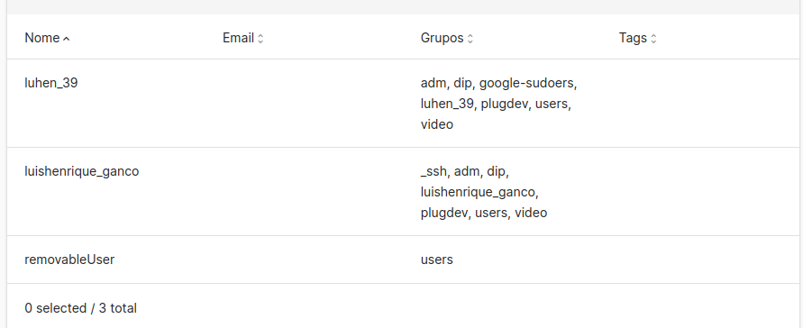
> Lista de utilizadores antes da execução do *script*

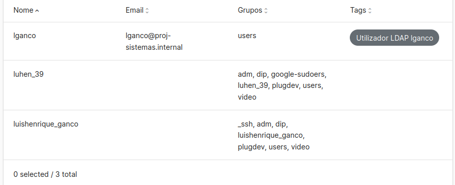
> Lista de utilizadores após a execução do *script*

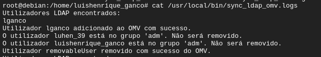
> *Logs* do *script*, descrevendo as alterações feitas à base de dados de utilizadores do OMV.

O *script* foi configurado para ser executado a cada hora (16:00, 17:00, etc), como podemos ver na imagem seguinte.

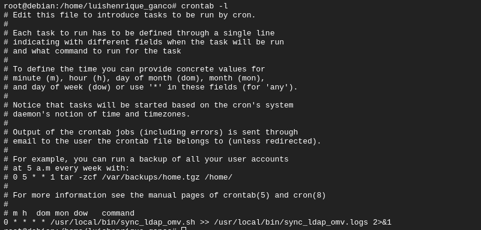

## Sistema de *backup*: RAID 1

Para o sistema de *backup* do OMV escolhemos usar RAID 1, por uma questão de simplicidade. Nas imagens seguintes podemos ver as configurações do mesmo.

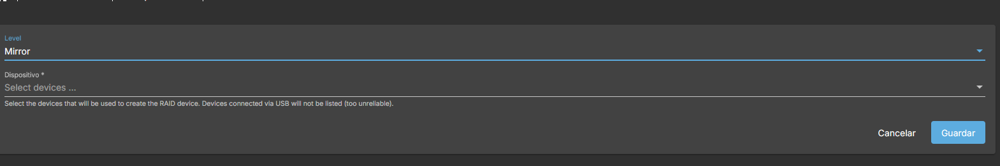
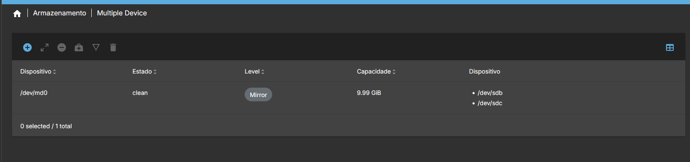

## Outras configurações

Para poder utilizar o serviço *share* do OpenMediaVault é necessário fazer as seguintes alterações na máquina OMV:

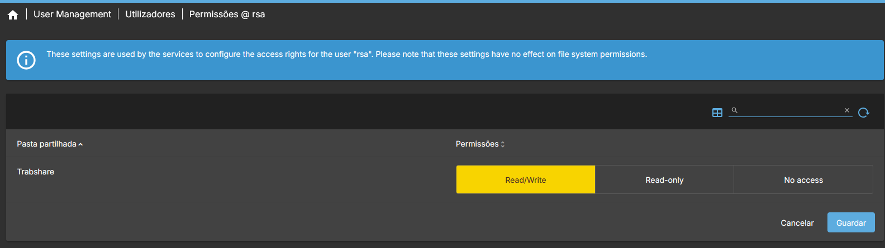

O processo de instalação de OpenLDAP na máquina Windows está ilustrado nas seguintes imagens:

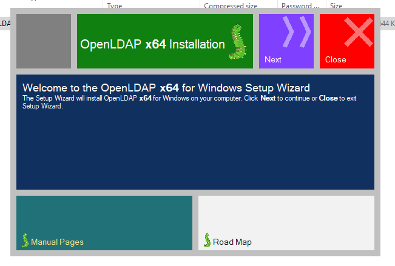
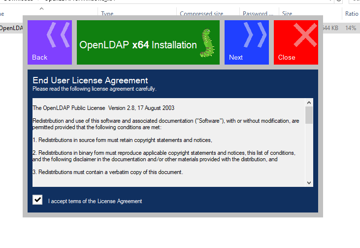
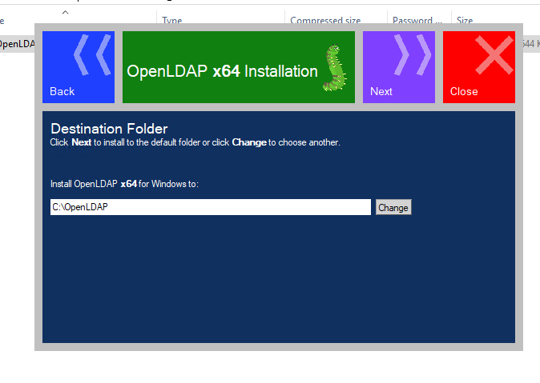
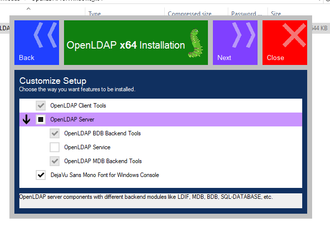
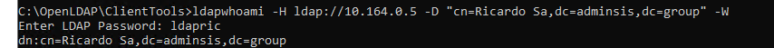

A configuração do SMB na máquina OMV foi feita da seguinte forma:

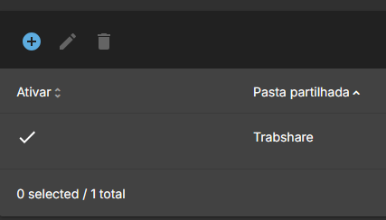
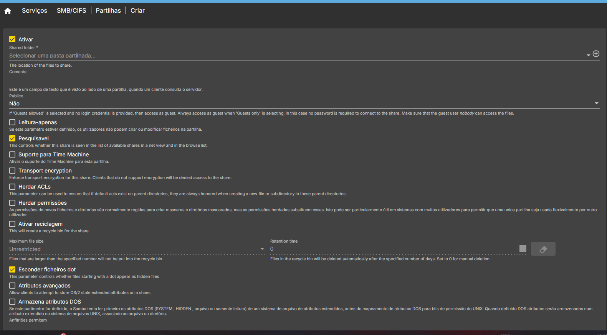
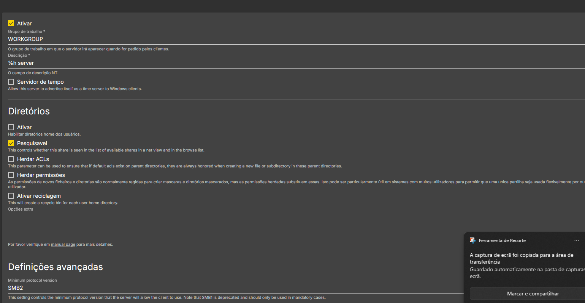

Para instalar o OpenLDAP no servidor Ubuntu seguimos [este tutorial](https://youtu.be/p857CNi60LM?si=n3LMQyKlC8fjil5P).

---

Final Grade: 15/20
